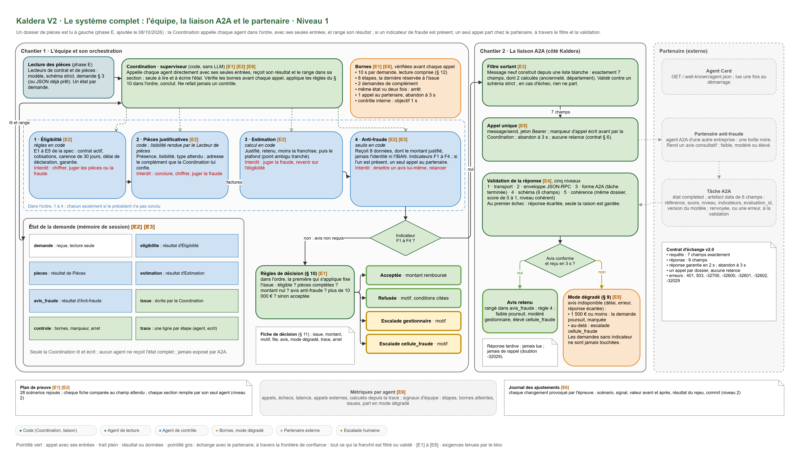

# Kaldera V2 : synthèse du dossier de conception

> Version courte du dossier de conception (28 pages) : le besoin, les livrables, l'équipe d'agents, l'échange A2A et ce qui est prouvé

## 1. Le besoin et les six exigences

Kaldera traite ses demandes de remboursement habitation avec un agent généraliste unique. Quand le partenaire anti-fraude ne répond pas, la demande reste bloquée, parfois des semaines. Le partenaire impose en plus un contrat strict (version 2.0) : sept champs exactement, aucune donnée personnelle, un seul appel par dossier, aucune relance.

La réponse est une équipe d'agents coordonnée, qui appelle le partenaire en A2A. Le tableau suit les six exigences de la direction : comment chacune est tenue, et ce qui le prouve.

| Exigence | Comment elle est tenue | Preuve |
|---|---|---|
| [E1] Une décision ou une escalade motivée, jamais un blocage | la Coordination seule conclut, en appliquant les règles du § 10 dans l'ordre ; une borne atteinte part en escalade avec le nom de la borne | invariant vérifié sur les 34 demandes ; BCL-01 arrêtée en 4 étapes, escalade motivée |
| [E2] Un rôle et une frontière par agent | une section de la mémoire par agent ; tout autre rangement est refusé (erreur de droits) | invariant vérifié sur chaque scénario |
| [E3] Seules les données du contrat sortent | message neuf construit depuis une liste blanche de sept champs, vérifié par un schéma avant l'envoi | AF-01 à 07 : 7 appels, 7 messages de sept champs |
| [E4] Une réponse non conforme est rejetée | validation en cinq niveaux ; au premier échec, l'avis est écarté et seule la raison est gardée | INV-01 à 07 : 7 réponses écartées au bon niveau |
| [E5] Mode dégradé si le partenaire est indisponible | règle du § 9 : 1 500 € ou moins, décision marquée `mode_degrade` ; au-delà, escalade `cellule_fraude` | PAN-01 (panne) et PAN-02 (partenaire à 5 s : lot de trois traité en 3,02 à 3,04 s) |
| [E6] Ni boucle, ni ajustement caché | bornes d'étapes, de compléments et de durée ; un appel au partenaire par dossier ; métriques calculées depuis la trace ; journal des ajustements | 18 appels, 0 doublon ; journal de 12 entrées |

## 2. Les livrables demandés, et où les trouver

Liens principaux :

- Version remise (tag `livrable-kaldera-v2-v3`) : [github.com/Ganda15/kaldera-bout-en-bout_v2, tag livrable-kaldera-v2-v3](https://github.com/Ganda15/kaldera-bout-en-bout_v2/tree/livrable-kaldera-v2-v3)
- Dossier de conception complet, 28 pages (téléchargement) : [livrable/dossier-de-conception.pdf](https://github.com/Ganda15/kaldera-bout-en-bout_v2/raw/livrable-kaldera-v2-v3/livrable/dossier-de-conception.pdf)
- Cette synthèse (téléchargement) : [livrable/synthese-dossier-de-conception.pdf](https://github.com/Ganda15/kaldera-bout-en-bout_v2/raw/livrable-kaldera-v2-v3/livrable/synthese-dossier-de-conception.pdf)

Le brief demande quatre livrables. Le troisième en regroupe trois (tests d'intégration, monitorage par agent, journal des ajustements), d'où six lignes. Chaque chemin est un lien vers la version remise.

| Livrable demandé par le brief | Où il se trouve | Contenu |
|---|---|---|
| Dossier de conception : carte des agents, orchestration et mémoire partagée, A2A et mode dégradé, plan d'épreuve | [livrable/dossier-de-conception.pdf](https://github.com/Ganda15/kaldera-bout-en-bout_v2/raw/livrable-kaldera-v2-v3/livrable/dossier-de-conception.pdf) | 28 pages : carte des agents (section 2), orchestration et mémoire (section 3), A2A et mode dégradé (section 4), plan d'épreuve (section 5) |
| L'équipe d'agents fonctionnelle, avec mémoire partagée et collaboration A2A | [src/kaldera/](https://github.com/Ganda15/kaldera-bout-en-bout_v2/tree/livrable-kaldera-v2-v3/src/kaldera) | la Coordination (`coordination.py`), les agents (`agents/`), la mémoire de la demande (`etat.py`), le client A2A avec son filtre et sa validation (`a2a/`) |
| Les tests d'intégration multi-agents | [tests/integration/](https://github.com/Ganda15/kaldera-bout-en-bout_v2/tree/livrable-kaldera-v2-v3/tests/integration) | 37 tests : les 28 scénarios rejoués dans toute l'équipe contre le partenaire simulé, et le chemin public vers le partenaire |
| Le monitorage par agent | [src/kaldera/metriques.py](https://github.com/Ganda15/kaldera-bout-en-bout_v2/blob/livrable-kaldera-v2-v3/src/kaldera/metriques.py) | appels, échecs, latence et appels externes de chaque agent, calculés depuis la trace ; le même tableau s'affiche sur le poste du gestionnaire |
| Le journal des ajustements d'orchestration | [conception/journal-ajustements.md](https://github.com/Ganda15/kaldera-bout-en-bout_v2/blob/livrable-kaldera-v2-v3/conception/journal-ajustements.md) | 12 entrées : signal observé, valeur avant et après, résultat du rejeu, commit |
| La preuve d'exécution des tests d'acceptance | [evaluation/acceptance/preuve-execution.md](https://github.com/Ganda15/kaldera-bout-en-bout_v2/blob/livrable-kaldera-v2-v3/evaluation/acceptance/preuve-execution.md) | 56 tests réussis sur 56, rapport généré par `outils/preuve_acceptance.py` ; l'épreuve sur les 28 scénarios est dans [evaluation/epreuve/rapport.md](https://github.com/Ganda15/kaldera-bout-en-bout_v2/blob/livrable-kaldera-v2-v3/evaluation/epreuve/rapport.md) |

## 3. L'équipe : huit rôles internes, un seul qui conclut

| Rôle | Réalisation | Ce qu'il fait |
|---|---|---|
| Coordination | code | délègue chaque contrôle dans l'ordre de la spécification, range les résultats, applique les règles du § 10 et conclut ; seule à lire et écrire la mémoire de la demande |
| Éligibilité, Pièces, Estimation | code | conditions du contrat ; présence et lisibilité des pièces ; montants, franchise et plafond |
| Anti-fraude | code | indicateurs F1 à F4 ; seul agent à appeler le partenaire, une fois, puis contrôle de la réponse |
| Lecteur de contrat, lecteur de pièces | modèle | lisent le contrat en PDF et le total des factures en photo |
| Documents et cohérence | modèle et code | le modèle interprète chaque pièce ; le code calcule le verdict de concordance avec la déclaration |
| Partenaire anti-fraude | agent externe | rend l'avis de fraude, « jamais en interne » ; il appartient à une autre entreprise |

**Où un modèle est utilisé, et pourquoi.** Un modèle (gpt-5.4, Azure AI Foundry) n'intervient que là où il faut interpréter un document, avec un format de sortie strict, une règle d'échec écrite et une mesure. Aucune règle chiffrée de la spécification (§ 4 à § 10) ne lui est confiée, et il ne conclut jamais une demande.

| Usage | Si le modèle échoue | Mesure |
|---|---|---|
| Lecture du contrat | escalade vers un gestionnaire | 5 champs justes sur 34 contrats sur 34 ; 1,69 s par appel |
| Lecture des factures | pièce jugée illisible, demande de complément ; jamais un montant inventé | montants 33 sur 33, lisibilité 68 sur 68 ; 2,10 s |
| Cohérence des pièces avec la déclaration | contrôle « non effectué », une personne reprend la demande | 42 dossiers : 6 contradictions sur 6, aucune fausse contradiction ; 3,97 s |

Point ambigu tranché : la spécification range le plafond dans l'éligibilité, mais l'éligibilité « ne chiffre pas la demande ». L'Estimation l'applique donc. Le scénario NOM-05 le confirme : 3 900 € dus, plafonnés à 3 000 €.

La vue d'ensemble de l'équipe, de la liaison A2A et du partenaire est en figure 1, en fin de document.

## 4. Orchestration, bornes et mémoire

La Coordination est un superviseur en séquence. Les agents ne s'appellent jamais entre eux et ne choisissent pas l'étape suivante. Il n'existe que deux issues : une décision (acceptée ou refusée) ou une escalade, avec sa file et un motif lisible.

Les bornes : 10 s par demande, depuis l'arrivée du dossier ; 8 étapes au plus ; 2 demandes de complément ; arrêt immédiat si le même état revient ; 1 appel au partenaire par dossier, abandonné au plus tard à 3 s, ou plus tôt s'il reste moins de temps à la demande. Deux valeurs sont tirées de la mesure par une règle écrite : la réserve de 0,4 s pour produire la fiche, et le délai minimal de 0,15 s sous lequel aucun appel ne part, pour ne pas gâcher le seul permis.

La mémoire de la demande est un état par demande. Seule la Coordination le lit et l'écrit, et une table fixe associe chaque agent à sa section. Les demandes d'un lot sont traitées en concurrence : une panne du partenaire ne retarde pas les autres.

## 5. L'échange A2A et le mode dégradé

Le partenaire n'est appelé que si un indicateur est présent (montant élevé, contrat récent, sinistres répétés, écart de plus de 20 % avec les factures). Le message est construit champ par champ depuis la liste blanche, jamais en retirant des champs de la demande complète. La réponse passe cinq niveaux dans l'ordre : transport, JSON et enveloppe JSON-RPC, forme A2A, schéma, cohérence avec le dossier envoyé. Aucune erreur ne déclenche de relance.

Sans avis exploitable (délai dépassé, erreur ou réponse écartée), une seule règle s'applique, celle du § 9. La fiche porte `mode_degrade: true` pour un contrôle a posteriori.

## 6. Ce qui est prouvé, et ce qui ne l'est pas

| Preuve | Résultat |
|---|---|
| Tests d'acceptance fournis | 56 sur 56, dont les 16 de la liaison avec le partenaire |
| Tests automatisés, intégration continue (12/10/2026) | 417 : 324 unitaires, 56 d'acceptance, 37 d'intégration |
| Épreuve sur les 28 scénarios (34 demandes) | 34 sur 34 conformes ; 18 appels au partenaire, 0 doublon ; trace la plus longue de 6 étapes |
| Les tests attrapent-ils un défaut ? | trois défauts volontaires introduits puis retirés, tous détectés (9, 5 et 16 échecs) |
| Évaluations réelles du modèle | **toutes deux « échouées »** : lecture, 32 issues sur 34 identiques au chemin JSON pour un seuil de 95 % ; cohérence, 1 échec technique sur 42 dossiers pour un seuil de zéro |

Limites écrites : pas de test de charge ; un partenaire simulé ; des documents générés à partir des 34 demandes, pas de vrais scans ; aucune alerte automatique vers l'exploitation ; un registre des appels qui ne survit pas à un redémarrage. Trois points restent à trancher par le client : la file de l'escalade sur borne, les refus automatiques au regard de l'article 22 du RGPD, et la conservation des traces.

## 7. Où trouver le détail

| Sujet | Dossier complet |
|---|---|
| Rôles, frontières, point ambigu, usages du modèle et captures du poste | section 2 |
| Règles du § 10, bornes et mémoire partagée | section 3 |
| Contrat, filtre, validation en cinq niveaux, mode dégradé | section 4 |
| Plan d'épreuve, résultats par famille de scénarios, journal des ajustements | section 5 |
| Points ouverts et limites | section 6, puis le glossaire et les sources en fin de dossier |

